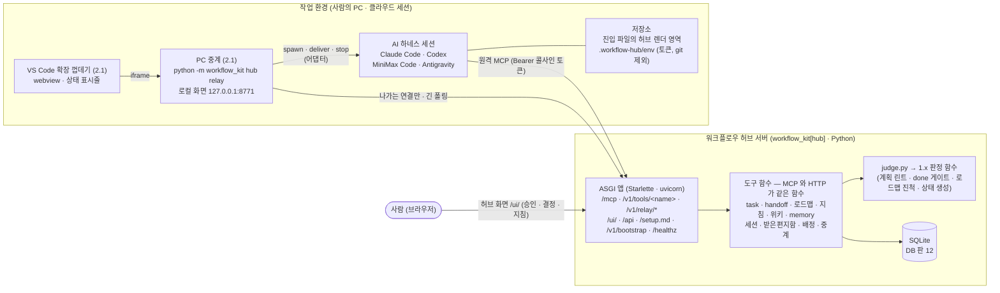
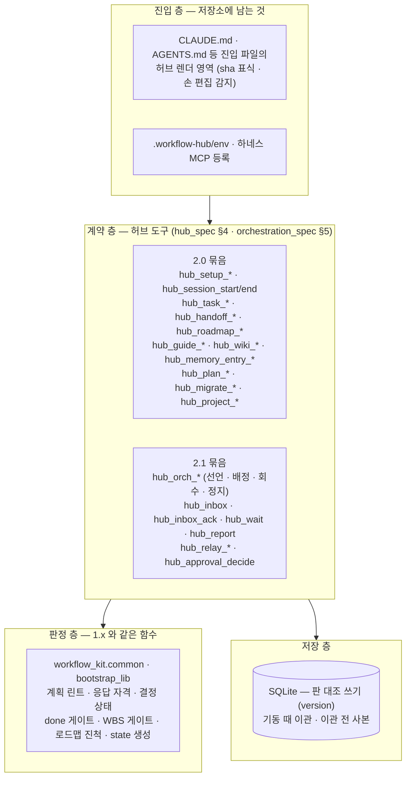
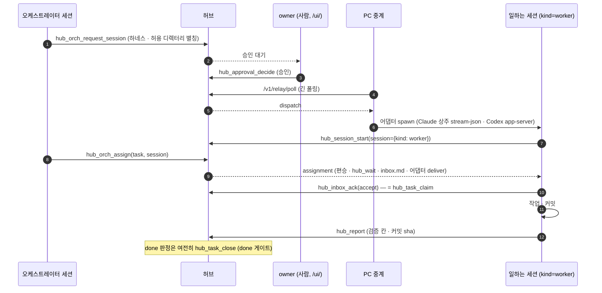

# Standard AI Workflow

- 문서 목적: 여러 프로젝트가 같이 쓰는 표준 AI 협업 워크플로우를 **워크플로우 허브**로 제공하는 이 저장소의 구성 · 아키텍처 · 진입 경로를 한 장으로 보여 준다.
- 범위: 2.0 허브 · 2.1 허브 오케스트레이션(PC 중계 · VS Code 확장 껍데기) · 1.x 독립 kit 유지보수 줄 · 저장소 구조 · 개발과 검증
- 대상 독자: 허브 관리자, 허브를 쓰는 저장소 주인, AI 에이전트 설계자, 이 저장소 기여자
- 상태: beta (2.0 허브 2.0.0 — 계약 보장 전)
- 최종 수정일: 2026-11-24
- 버전: v3.1.0 (Go 허브 pre-release pilot; package: standard-ai-workflow 3.1.0, runtime `__version__` = 3.1.0, latest tag **v3.1.0**. GitHub 안정판 latest 는 **v2.1.0** 유지)
- 관련 문서: [`docs/HUB_OPERATIONS.md`](./docs/HUB_OPERATIONS.md), [`workflow-source/core/hub_spec.md`](./workflow-source/core/hub_spec.md), [`workflow-source/core/hub_orchestration_spec.md`](./workflow-source/core/hub_orchestration_spec.md), [`docs/INSTALLATION_AND_USAGE.md`](./docs/INSTALLATION_AND_USAGE.md), [`docs/LOCAL_GATE.md`](./docs/LOCAL_GATE.md)

## 1. 한눈에

작업 상태 — task · handoff · 이력 · 로드맵 · 공유 지침 · 위키 · memory_index — 의 정본이 **허브 서버 하나**에 있다.
작업 환경(저장소 + AI 하네스)은 kit 를 깔지 않고 **허브 주소 하나**로 참여한다. kit 는 허브 서버 안에서 돈다.

| 판 | 어디에 | 상태 | 한 줄 |
|---|---|---|---|
| **2.0** 워크플로우 허브 | `main` · 태그 `v2.0.0` | 발행 (베타 표기) | 허브 서버 + 원격 MCP + 허브 화면. 저장소는 진입 파일 한 영역과 토큰 파일만 가진다 |
| **2.1** 허브 오케스트레이션 | `main` (M-041~M-048) | v2.1.0 발행 · 안정판 latest | 오케스트레이터 세션이 일하는 세션들에게 배정 · 받은편지함 · PC 중계로 하네스 세션 띄우기 · VS Code 확장 |
| **3.0.1** Go 허브 pilot | `main` | pre-release · 실험용, Python parity 미완료 | Go 6개 대상 바이너리와 Python `hub serve` fallback. 실험은 운영 DB가 아닌 일관된 사본에서 수행한다 |
| **1.x** 독립 kit | [`release/1.x`](https://github.com/ykylee/standard_ai_workflow/tree/release/1.x) | 유지보수 (결함 수리만, 2028-07-20 까지) | 각 저장소에 kit 를 깔고 `ai-workflow/memory/` 파일로 상태를 두는 판 |

배포는 GitHub Releases 하나다 (PyPI 에 올리지 않는다 — [`docs/RELEASE.md`](./docs/RELEASE.md) §1).

## 2. 시스템 구성도



- **나가는 연결만**: 하네스와 중계는 허브로 나가는 HTTP 만 쓴다. 허브는 작업 환경에 접속하지 않고, 프로젝트 git 원격에도 붙지 않는다 (위키 원격 읽기를 켠 프로젝트만 예외).
- **토큰은 파일 하나에만**: 콜사인 토큰은 작업 환경의 `.workflow-hub/env` (600, git 제외) 에만 있다. 허브 기록 어디에도 토큰이 실리지 않는다 — 쓰기 전에 토큰과 같은 문자열을 찾으면 `secret_in_payload` 로 거절한다.
- **기본은 loopback**: 허브는 `127.0.0.1:8770` 에 뜬다. 바깥 노출은 TLS 리버스 프록시 뒤에서 하고 `--public-url` 로 공개 주소를 알려 준다.

## 3. 아키텍처

### 3.1 층



| 원칙 | 내용 |
|---|---|
| 같은 판정 | 허브는 1.x 판정 함수를 **그대로** 부른다 (`hub/judge.py`). 1.x 생성물 형식(`state.json` 등)도 그대로 낸다. |
| 같은 함수 두 입구 | MCP 도구와 `POST /v1/tools/<name>` 은 같은 함수 · 같은 인자 · 같은 결과다. |
| 조용한 기본값 없음 | 모르는 필드 · 계약 판 · 클라이언트 판은 거절한다. 재지 못한 것은 '미측정' 이지 통과가 아니다. |
| 시계는 한 번 | 허브가 시각을 정해 판정 함수에 인자로 넘긴다. |
| 낙관적 동시성 | 쓰기는 `version` 대조 — 409 `version_conflict` 면 다시 읽고 판단한다. |
| 사람만 하는 일 | 결정 답 · 지침 판 올리기 · 콜사인 승인 · 세션 띄우기 승인은 **승인된 human 콜사인** 만 한다. 에이전트는 제안한다. |

### 3.2 허브 모듈 (`workflow-source/workflow_kit/hub/`)

| 모듈 | 몫 |
|---|---|
| `app.py` | ASGI 앱 조립 — `/mcp` (MCP streamable HTTP) · `/v1/tools` · `/v1/relay` · 화면 · 인증 앞단 |
| `db.py` · `store.py` | 스키마 · 이관 · 백업 · 판 대조 쓰기 |
| `tools.py` | 2.0 도구 함수 |
| `session.py` · `orchestration.py` | 세션 식별 · 받은편지함 · 대기 · 오케스트레이터 lease · 배정 상태 기계 (2.1) |
| `relay.py` | PC 중계 쪽 API — 초대 · 등록 · 긴 폴링 · 결과 (2.1) |
| `judge.py` | 1.x 판정 함수의 데이터 입구 |
| `render.py` · `_standard_snapshot.py` · `guide.py` · `guide_page.py` · `setup.py` | 진입 파일 렌더 영역 · 표준 지침 사본 · 안내 페이지 · `/setup.md` · 셋업 지시 |
| `wiki.py` · `wiki_remote.py` · `memory.py` | 위키 · ingest · lint · 원격 읽기 · memory_index |
| `migrate1x.py` · `transfer.py` | 1.x 저장소 들여오기 · 허브 간 프로젝트 이전 (봉인 · 초대 코드) |
| `gitkey.py` | git 주소 정규화 (프로젝트 식별) |
| `ui.py` · `static/` | 허브 화면 `/ui/` · `/api` |
| `client/hub_client.py` | 선택 클라이언트 — 표준 라이브러리만, `/v1/bootstrap` 이 내려준다 (부트스트랩 · 보낼편지함 · 들여오기) |

### 3.3 2.1 오케스트레이션 흐름

오케스트레이터 세션(사람이 지정, lease) 이 일하는 세션들에게 task 를 배정한다. 메시지는 허브 받은편지함에 쌓이고, 세션은
네 경로 중 하나로 받는다 — **도구 응답 편승**(`hub_inbox` 칸) · **대기 도구**(`hub_wait`) · **받은편지함 파일**(`.workflow-hub/inbox.md`, 중계가 씀) · **중계 어댑터**(실행 중 턴에 끼우기).



- 배정 상태: `offered` → `accepted` → `reported`, 거절 · 10분 무확인 · 회수 · 세션 종료 · 24시간 진척 없음이면 `returned`.
- 전달 받은 지시라도 되돌릴 수 없는 일(삭제 · 덮어쓰기 · force push) · 비밀 · 프로젝트 밖 · 권한 바꾸기는 **수행하지 않고** decline 한다.
- **PC 중계**는 사람이 허용 목록(디렉터리 별칭 · 하네스 · 권한 모드 · 세션 상한)에 적은 범위만 띄운다. bypass 계열 권한 모드는 받지 않는다. Codex 는 `workspace-write` 샌드박스에서 git 디렉터리를 쓰기 루트에 더해 커밋까지 하고, push 는 오케스트레이터 · 사람이 한다.
- **VS Code 확장** (`editors/vscode/`) 은 껍데기다 — 중계 로컬 화면을 webview 에 띄우고 상태 표시줄에 세션 수를 보인다. 화면 로직은 Python 한 벌.

## 4. 저장소 구조

| 경로 | 몫 |
|---|---|
| `workflow-source/` | **배포 패키지 `workflow_kit` 의 원본** (`pyproject.toml`, wheel 은 `workflow_kit` 하나) |
| `workflow-source/workflow_kit/hub/` | 2.0 허브 서버 · 2.1 오케스트레이션 |
| `workflow-source/workflow_kit/relay/` | 2.1 PC 중계 — `cli.py` · `conn.py` · `runner.py` · `ui.py` · `adapters/{claude_code,codex,fake}.py` (표준 라이브러리만) |
| `workflow-source/workflow_kit/` (나머지) | 1.x kit — `common/` 판정 · 상태 · `bootstrap_lib/` 하네스 진입 파일 생성 · `workbench/` · `server/` read-only MCP · `tools/` CLI (`python -m workflow_kit …`) |
| `workflow-source/core/` | 계약 · 표준 정본 문서 (`hub_spec.md` · `hub_orchestration_spec.md` · `hub_workflow_standard.md` · `global_workflow_standard.md` · 로드맵 스펙 등) |
| `workflow-source/tests/` | 게이트 검사 (`check_*.py`) 와 러너 `run_all_checks.py` |
| `workflow-source/releases/` | 릴리스 노트 |
| `editors/vscode/` | VS Code 확장 껍데기 (빌드 없는 JavaScript, wheel 밖) |
| `plugin/` | 1.x Claude Code 플러그인 (스킬 7종 · hook · MCP 등록) — 2.0 은 플러그인 채널을 내지 않는다 |
| `docs/` | 운영 가이드 (`HUB_OPERATIONS.md`) · 설치 · 릴리스 · 로컬 게이트 · 기획 (`planning/`) · 아키텍처 결정 |
| `ai-workflow/` | **이 저장소 자신의** 워크플로우 상태 (1.x 형식 — 브랜치별 `memory/active/<branch>/`, 로드맵 `memory/active/roadmap/`, 위키) |

## 5. 시작하기

### 5.1 허브 관리자 — 허브 띄우기

```sh
python3 -m venv ~/workflow-hub/venv
~/workflow-hub/venv/bin/python -m pip install "<GitHub Release 의 workflow_kit wheel>[hub]"
~/workflow-hub/venv/bin/python -m workflow_kit hub serve --db ~/workflow-hub/hub.db \
    [--bind 127.0.0.1] [--port 8770] [--public-url https://hub.example.org]
```

토큰 · 백업 · 판 올리기 · 허브 간 이전 · 점검은 [`docs/HUB_OPERATIONS.md`](./docs/HUB_OPERATIONS.md).

### 5.2 저장소 주인 — 프로젝트 셋업

작업 환경의 에이전트에게 한 줄이면 된다:

> `<public-url>/setup.md` 를 읽고 이 저장소를 셋업해. 콜사인은 `<이름>`, 나는 사람(human)이다.

에이전트가 등록(또는 합류) · `.gitignore` · 토큰 파일 · 진입 파일 렌더 영역 · 하네스 MCP 등록을 하고, 하네스 안전 장치가 걸린
단계는 사람에게 넘긴다. 지원 하네스 4종(Claude Code · Codex · MiniMax Code · Antigravity) 모두 빈 폴더에서 이 페이지만 읽고
셋업을 마친 실측이 있다. 1.x 를 쓰던 저장소는 셋업 뒤 `hub_client.py migrate plan` → `migrate import` → '허브로 옮김' 표식.

### 5.3 PC 중계 (2.1, 선택)

```sh
python -m workflow_kit hub relay init --hub <public-url> --invite <owner 가 낸 초대 코드> --harness claude-code --harness codex
python -m workflow_kit hub relay allow add --alias <별칭> --path <디렉터리> --harness codex --permission-mode default
python -m workflow_kit hub relay serve --ui-port 8771
```

VS Code 에서 보려면 `editors/vscode/` 를 `.vsix` 로 묶어 설치한다 — [`editors/vscode/README.md`](./editors/vscode/README.md). 명령 인자의 정본은 `--help` 와 [`hub_orchestration_spec.md`](./workflow-source/core/hub_orchestration_spec.md) §9.

### 5.4 1.x 독립 kit 에 머문다면

[`release/1.x`](https://github.com/ykylee/standard_ai_workflow/tree/release/1.x) 브랜치와 그 README 를 따른다. 1.x 의 공개 Python API 와
`python -m workflow_kit` 명령은 2.0 에서도 지워지지 않는다. 1.x 가 진입 파일을 만드는 하네스 10종:
`claude-code` · `codex` · `opencode` · `antigravity` · `minimax-code` · `codewhale` · `aider` · `goose` · `grok-build` · `pi-dev`.
설치 · 부트스트랩 · MCP 등록은 [`docs/INSTALLATION_AND_USAGE.md`](./docs/INSTALLATION_AND_USAGE.md).

## 6. 이 저장소 개발

```sh
python3 -m venv .venv
.venv/bin/python3 -m pip install -r requirements.txt -r requirements-dev.txt
.venv/bin/python3 -m pip install -e "./workflow-source[dev,release,mcp-sdk]"
git config core.hooksPath .githooks
```

| 단계 | 명령 |
|---|---|
| 커밋 전 | `.venv/bin/python3 workflow-source/tests/run_all_checks.py --changed --tmp-dir=<실디스크경로>` + `.venv/bin/python3 workflow-source/tests/check_self_application.py` |
| push 직전 (게이트) | 커밋 뒤 깨끗한 트리에서 `run_all_checks.py --branch-context=all --tmp-dir=<실디스크경로>` |
| 한 검사만 | `run_all_checks.py --filter=<이름조각> --tmp-dir=<실디스크경로>` |

- CI 는 없다 — 로컬 게이트가 정본이다. 근거와 검사 작성 규약은 [`docs/LOCAL_GATE.md`](./docs/LOCAL_GATE.md).
- 시스템 `python3` 이 아니라 저장소 `.venv` 로 돌린다 (dev 의존 부재로 오탐이 난다). `--tmp-dir` 는 tmpfs 가 아닌 실디스크 경로.
- 작업 흐름(세션 시작 → task 등록 → 단계별 진행 → 검증 → 커밋 · push) 은 [`CLAUDE.md`](./CLAUDE.md) · [`AGENTS.md`](./AGENTS.md) 의 진입 규칙을 따른다.
- 진척은 로드맵 · 마일스톤 · WBS 로 관리한다 — [`ai-workflow/memory/active/roadmap/index.md`](./ai-workflow/memory/active/roadmap/index.md).

## 7. 문서 지도

| 알고 싶은 것 | 문서 |
|---|---|
| 허브 운영 (설치 · 토큰 · 백업 · 이전 · 점검) | [`docs/HUB_OPERATIONS.md`](./docs/HUB_OPERATIONS.md) |
| 2.0 허브 계약 (명령 · 표 · 도구 · 흐름 · 오류) | [`workflow-source/core/hub_spec.md`](./workflow-source/core/hub_spec.md) |
| 2.1 오케스트레이션 계약 (세션 · 배정 · 중계 · 화면 · 진입 규칙) | [`workflow-source/core/hub_orchestration_spec.md`](./workflow-source/core/hub_orchestration_spec.md) |
| 진입 파일에 렌더되는 표준 규칙 | [`workflow-source/core/hub_workflow_standard.md`](./workflow-source/core/hub_workflow_standard.md) |
| 왜 허브인가 · 요구 · 실측 | [`docs/planning/workflow-hub-requirements-2026-11.md`](./docs/planning/workflow-hub-requirements-2026-11.md) · [`docs/planning/hub-orchestration-requirements-2026-11.md`](./docs/planning/hub-orchestration-requirements-2026-11.md) |
| 1.x 공통 표준 (세션 · 상태 · 메모리 규칙) | [`workflow-source/core/global_workflow_standard.md`](./workflow-source/core/global_workflow_standard.md) |
| 1.x 설치 · 사용 | [`docs/INSTALLATION_AND_USAGE.md`](./docs/INSTALLATION_AND_USAGE.md) · [`QUICKSTART.md`](./QUICKSTART.md) |
| 릴리스 절차 | [`docs/RELEASE.md`](./docs/RELEASE.md) |
| 로컬 게이트 | [`docs/LOCAL_GATE.md`](./docs/LOCAL_GATE.md) |
| 프로젝트 메타 · 목적 | [`docs/PROJECT_PROFILE.md`](./docs/PROJECT_PROFILE.md) · [`ai-workflow/memory/active/PURPOSE.md`](./ai-workflow/memory/active/PURPOSE.md) |
| 변경 이력 | [`workflow-source/releases/`](./workflow-source/releases/) · [GitHub Releases](https://github.com/ykylee/standard_ai_workflow/releases) |

## 8. 라이선스

[MIT](./LICENSE). 외부 참고(Karpathy LLM Wiki · llm_wiki · OpenCode · Aider 등)는 개념만 흡수하고 코드는 차용하지 않는다.
